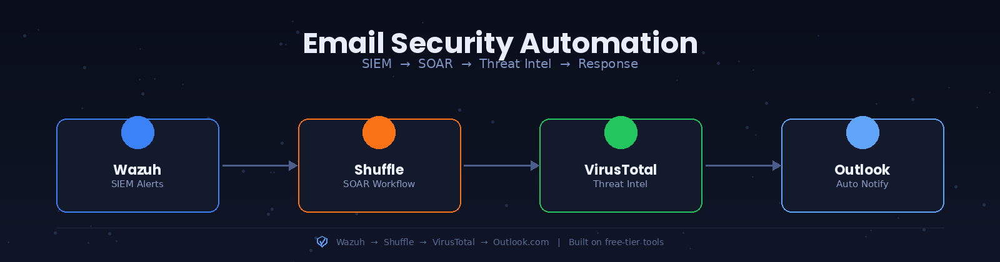

# 🛡️ Email Security Automation: Wazuh SIEM → Shuffle SOAR Pipeline

A hands-on home lab demonstrating end-to-end security automation — ingesting SIEM alerts and user-reported phishing emails, applying severity-based triage, enriching suspicious URLs via threat intelligence, and auto-notifying with a verdict — built entirely on free-tier tools with zero paid infrastructure.

> ⚠️ **Disclaimer:** This project was performed entirely within an isolated, self-owned VirtualBox lab environment using a dedicated throwaway Outlook.com test mailbox and sample/dummy phishing content. It is intended strictly for educational and skill-demonstration purposes.

---

## 📑 Table of Contents
- [🎯 Overview](#-overview)
- [🧩 Lab Architecture](#-lab-architecture)
- [⚙️ Environment Setup](#️-environment-setup)
- [🔗 Wazuh → Shuffle Integration](#-wazuh--shuffle-integration)
- [🚦 Phase 1: Severity-Based Alert Triage](#-phase-1-severity-based-alert-triage)
- [📧 Phase 2: Automated Phishing Report Intake](#-phase-2-automated-phishing-report-intake)
- [🔬 Phase 3: Threat Intelligence Enrichment](#-phase-3-threat-intelligence-enrichment)
- [📬 Phase 4: Automated Verdict Notification](#-phase-4-automated-verdict-notification)
- [📊 Results Summary](#-results-summary)
- [🎓 Key Takeaways](#-key-takeaways)
- [🧰 Tools Used](#-tools-used)

---

## 🎯 Overview

The goal of this project was to build a working SIEM-to-SOAR pipeline that mirrors how a real SOC automates first-line triage — without needing a paid SIEM license, a paid mail tenant, or a paid threat-intel subscription. The pipeline handles two independent alert sources:

1. **🔍 SIEM Alerts** — Wazuh forwards every security event to Shuffle, which filters by severity so only meaningful alerts get attention.
2. **📧 User-Reported Phishing** — A monitored inbox is polled on a schedule; any reported email has its embedded URL automatically submitted to VirusTotal, scanned, and the verdict emailed back — with no analyst needing to touch it.

Both branches run independently inside a single Shuffle workflow, reflecting how real automation platforms handle multiple trigger sources feeding one case-management surface.

---

## 🧩 Lab Architecture

| Component | Role |
|---|---|
| Wazuh 4.9.2 (indexer, manager, dashboard) | SIEM — alert generation and local host monitoring |
| Ubuntu 24.04 LTS (VirtualBox) | Wazuh manager host |
| Shuffle | SOAR — workflow orchestration, free tier |
| Outlook.com (free personal account) | Phishing-report intake mailbox, via Microsoft Graph OAuth |
| VirusTotal API | URL reputation / threat intelligence enrichment, free tier |

```
Wazuh Manager (VirtualBox VM)
   │
   ├─ custom-shuffle integration script
   ▼
Shuffle (SOAR)
   │
   ├── Branch 1 — SIEM Alert Triage
   │     Webhook → Severity Condition (level > 7) → Action
   │
   └── Branch 2 — Phishing Report Automation
         Schedule (poll every 2 min) → Outlook (fetch inbox)
            → VirusTotal (submit URL) → VirusTotal (get report)
            → Outlook (send verdict notification)
```

**🖥️ Wazuh dashboard — alert summary, agent health, and available modules:**

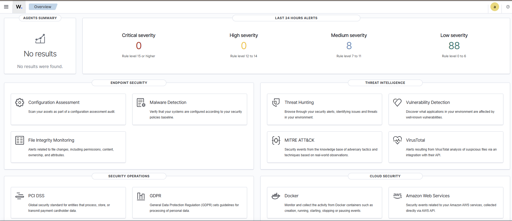

**✅ Local agent confirmed active:**

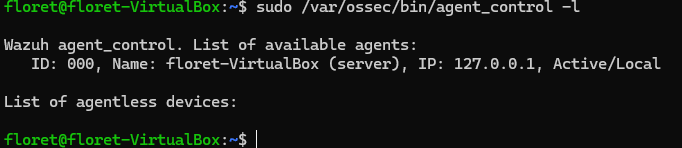

---

## 🔗 Wazuh → Shuffle Integration

A custom bash/curl integration script forwards every Wazuh alert to a Shuffle webhook as JSON:

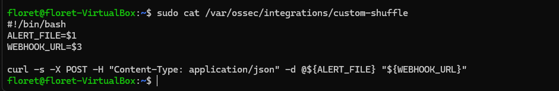

Registered via an `<integration>` block in `ossec.conf`:

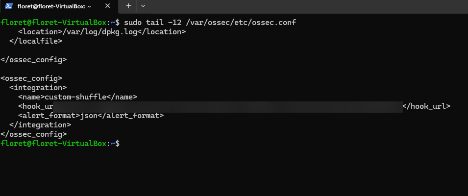

**🧠 Design note:** the script is deliberately minimal — it reads the alert file path and target webhook URL as arguments rather than hardcoding either, so the same script works unmodified across environments.

**Initial workflow scaffold — webhook wired to a placeholder action:**

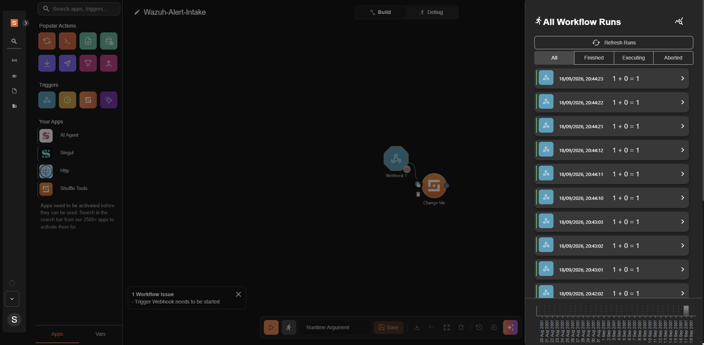

**✅ First successful automatic delivery, confirmed from both sides:**

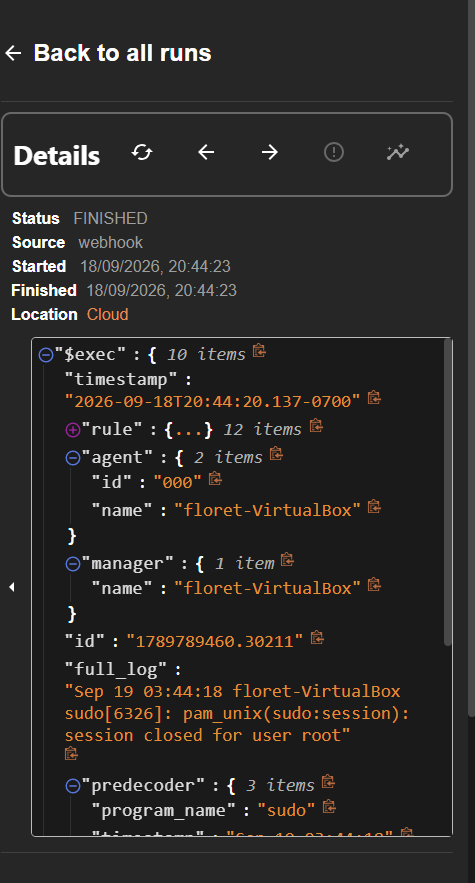
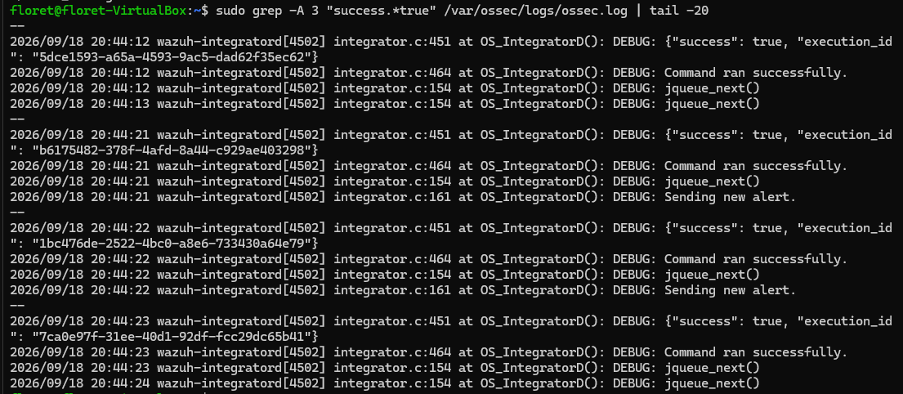

**📦 Raw alert payload as received by Shuffle** — this is the data contract the downstream severity logic depends on:

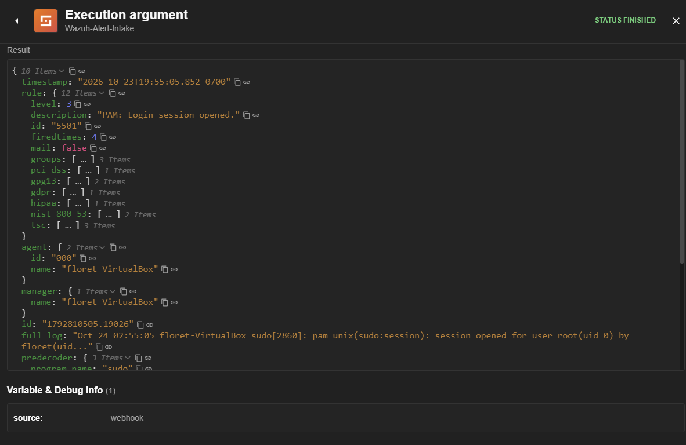

---

## 🚦 Phase 1: Severity-Based Alert Triage

A condition node filters every incoming alert by `rule.level`, so only meaningful events continue downstream:

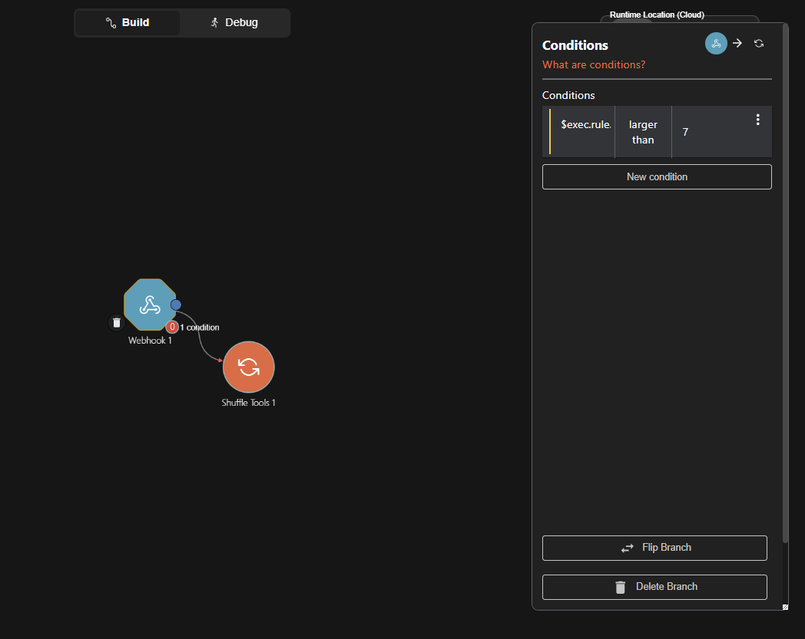

```
$exec.rule.level larger than 7
```

**Validated with both sides of the threshold:**

| Test | `rule.level` | Result |
|---|---|---|
| 🟡 Low severity | 7 | **Skipped** — condition evaluates false |
| 🔴 High severity | 8 | **Passed** — condition evaluates true |

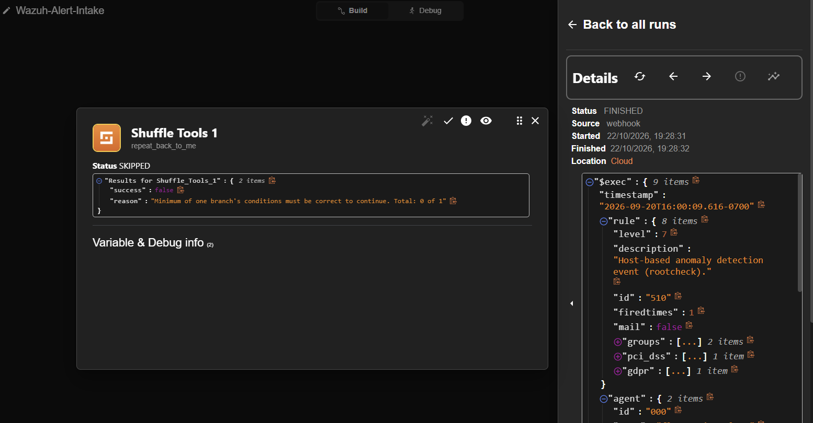
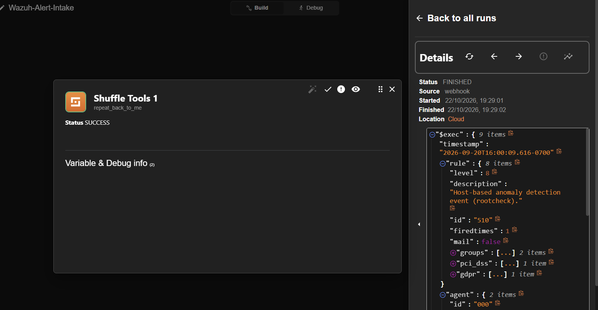

This confirms the filter is strictly exclusive of the threshold value — exactly the inclusive/exclusive boundary behavior a real triage rule needs to be verified for.

---

## 📧 Phase 2: Automated Phishing Report Intake

A free personal Outlook.com account was connected to Shuffle via Microsoft Graph OAuth — no paid Microsoft 365 tenant required:

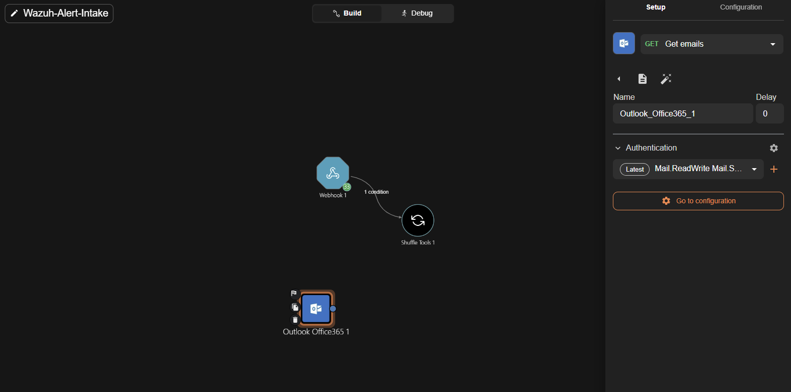

A scheduled trigger polls the inbox every 2 minutes, simulating a "report phishing" mailbox:

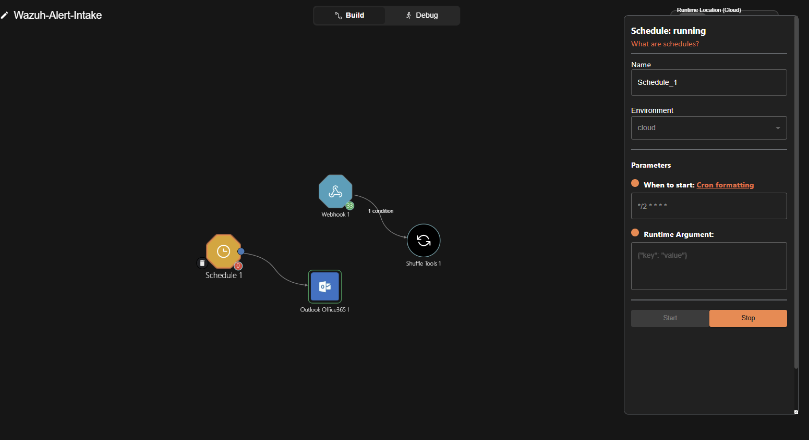

**Test phishing report received and picked up automatically — no manual trigger:**

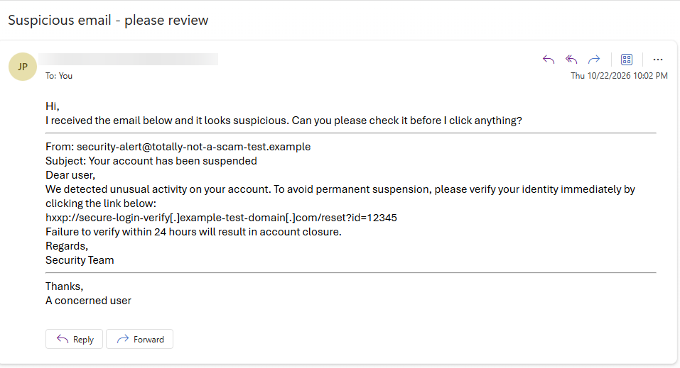
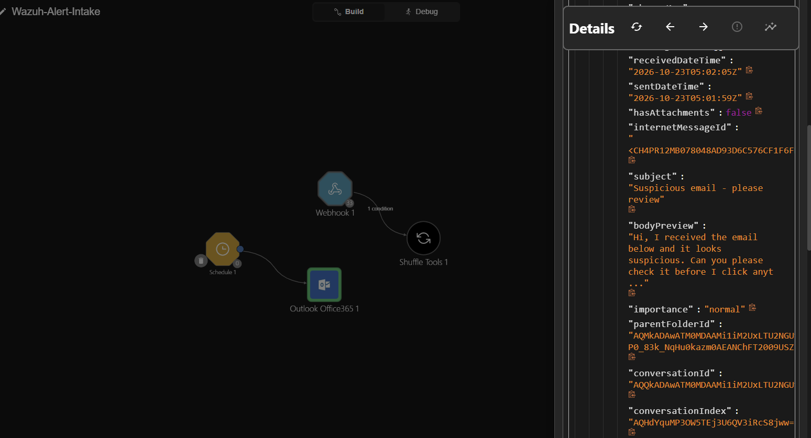

---

## 🔬 Phase 3: Threat Intelligence Enrichment

The URL from the reported email is submitted to VirusTotal's API for analysis, then the scan report is retrieved:

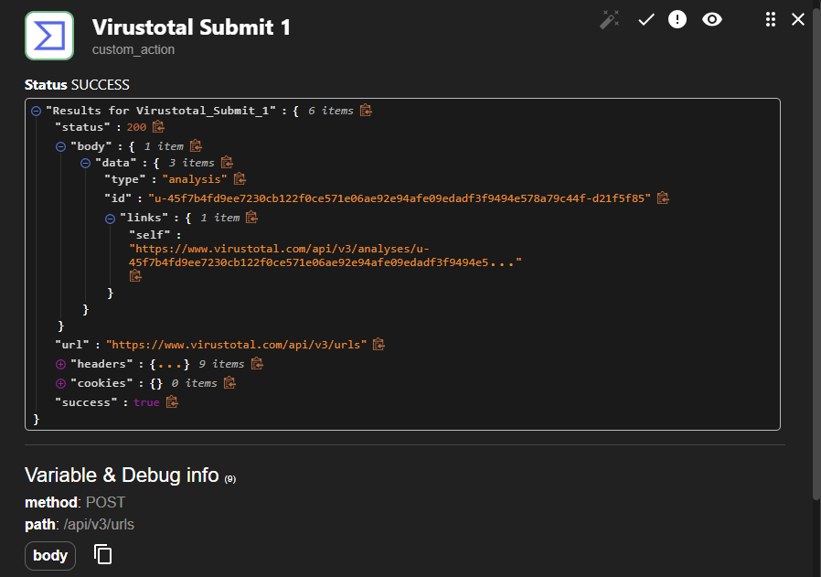
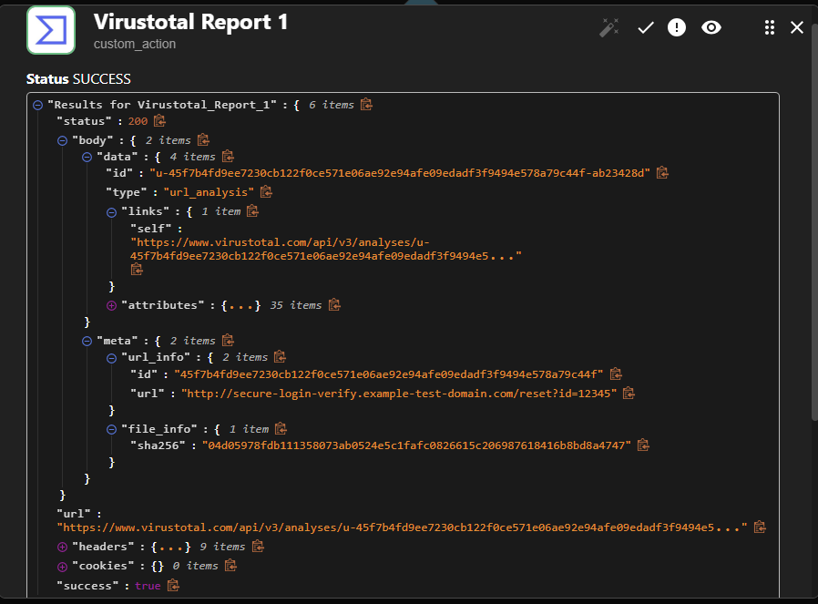

**🧠 Design note:** VirusTotal's URL analysis is asynchronous — a submission returns an analysis ID, which is then polled separately for the completed verdict, rather than a single synchronous lookup call.

---

## 📬 Phase 4: Automated Verdict Notification

The completed verdict — scanned URL, detection stats across security vendors, and a link to the full report — is emailed back to the reporting mailbox automatically:

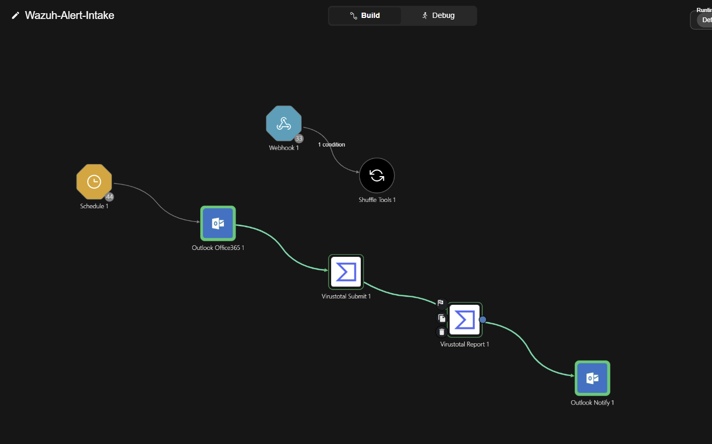
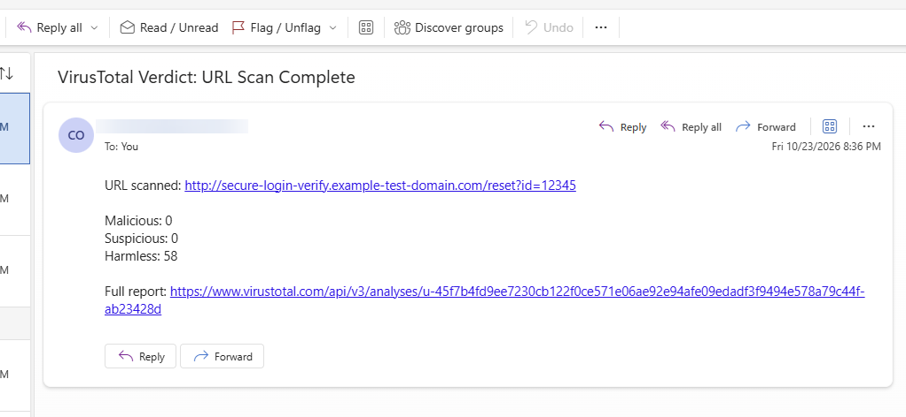

---

## 📊 Results Summary

| Branch | Trigger | Outcome |
|---|---|---|
| 🔍 SIEM Alert Triage | Wazuh webhook | Low-severity alerts filtered out; high-severity alerts pass through automatically |
| 📧 Phishing Report Automation | Scheduled inbox poll (every 2 min) | Real reported email detected → URL extracted → scanned → verdict delivered, fully unattended |

Both branches were validated with synthetic test payloads **and** at least one genuine, automatically-delivered real-world event (a real Wazuh alert and a real inbox-delivered email), rather than relying solely on manual test cases.

---

## 🎓 Key Takeaways

- **Severity filtering is a real design decision, not a formality.** Verifying both the pass and fail sides of a threshold condition is what actually proves a triage rule works as intended.
- **Free-tier tooling can fully replicate enterprise SOAR patterns.** A personal Outlook.com mailbox via Microsoft Graph OAuth provides the same automation capability as a paid Microsoft 365 tenant for this use case.
- **Multi-branch workflows reflect real SOC tooling.** Running independent trigger sources (webhook vs. scheduled poll) inside one orchestration platform, rather than building separate standalone scripts, mirrors how production SOAR platforms are actually structured.
- **Asynchronous API design matters for automation.** Threat-intel enrichment isn't always a single call-and-response — building a submit-then-poll pattern is a transferable skill for any real-world threat-intel integration.

---

## 🧰 Tools Used

- 🛡️ **Wazuh 4.9.2** — SIEM / host-based detection
- 📦 **VirtualBox** — virtualization platform
- 🐧 **Ubuntu 24.04 LTS** — Wazuh manager host
- 🔀 **Shuffle** — SOAR / workflow orchestration
- 📧 **Microsoft Graph API (Outlook.com)** — phishing-report mailbox
- 🔬 **VirusTotal API** — URL threat intelligence enrichment
